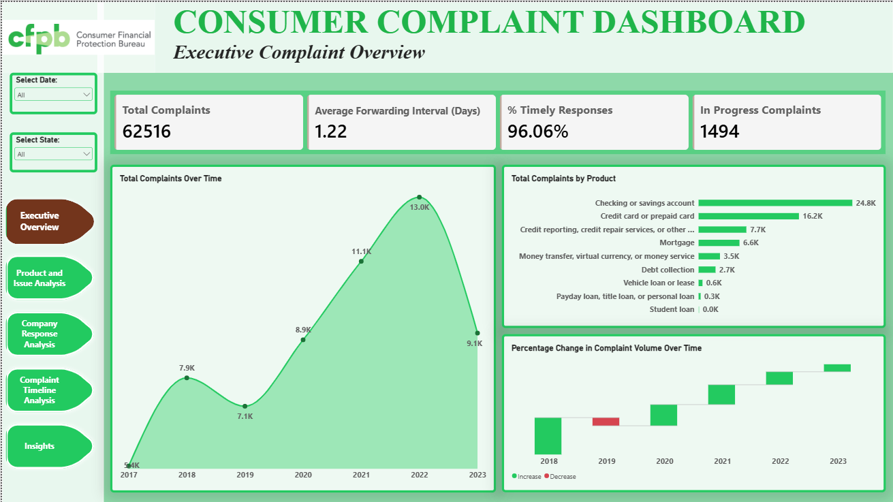

# Consumer-Complaint-Trends-and-Response-Intelligence-Analysis-Python-Power-BI
A comprehensive analysis of consumer complaints sent to the CFPB regarding the Bank of America.

## Project Overview
  

## Project Files

- [Power BI Dashboard](/Consumer_Complaints_Executive_Dashboard.pbix)
- [Dashboard Screenshots](/DASHBOARD_SCREENSHOTS_Consumer_Complaints.pdf)
- [Consumer_Complaints_Executive_Report](/Consumer_Complaints_Executive_Report.pdf)
- [Consumer_Complaints_Methodology](/Consumer_Complaints_Methodology.pdf)
- [Python_Notebook](/Consumer_Complaints_Data_Quality_Assessment.ipynb)
- [Consumer_Complaint_KPI_Validation_Evidence](/Consumer_Complaint_KPI_Validation_Evidence.pdf)

This project explores consumer complaints about Bank of America submitted to the Consumer Financial Protection Bureau (CFPB) between May 2017 and August 2023.

The objective was to analyse complaint trends, identify recurring consumer issues, examine the financial products and services generating the highest complaint volumes, and evaluate the bank's complaint response performance.

Through data analysis and visualisation, the project aims to uncover meaningful insights that can support better customer service, improve complaint management and inform business decision-making.

## Business Objectives

The analysis focused on five key objectives:

- Identify trends and patterns in consumer complaint volumes.
- Determine the most frequently reported consumer issues.
- Identify financial products and services associated with the highest complaint volumes.
- Examine company responses and assess response timeliness.
- Evaluate complaint-processing timelines, including the time taken to forward complaints to the company.

## Methodology
[Consumer_Complaints_Methodology](/Consumer_Complaints_Methodology.pdf)

## Dataset

**Source:** Consumer Financial Protection Bureau (CFPB) Consumer Complaint Database.

**Company analysed:** Bank of America.

**Reporting period:** May 2017 – August 2023.

**Total complaints analysed:** 62,516.

The dataset contains information relating to consumer complaints, including financial products, issues, submission channels, complaint dates, company responses, and processing timelines.

## Key Areas of Analysis

The project explored four key areas:

1. **Complaint Trends:** Examined changes in complaint volumes over time and identified patterns across the reporting period.
2. **Product and Issue Analysis:** Investigated the financial products, services and specific issues most frequently associated with consumer complaints.
3. **Company Response Analysis:** Evaluated Bank of America's recorded responses, response timeliness and complaint status.
4. **Complaint Processing Timeline:** Analysed the time taken for complaints to be forwarded to the company.

## Key Findings

Some of the major findings include:

- A total of 62,516 consumer complaints relating to Bank of America were recorded during the reporting period.
- Checking and savings accounts generated the highest complaint volume, with approximately 24,800 complaints.
- Account management was among the most frequently reported issues.
- Deposits and withdrawals were the most common recorded sub-issues.
- The Web was the most frequently used complaint submission channel.
- The average complaint forwarding interval was approximately 1.2 days, with a median of zero days.
- Bank of America recorded a timely response rate of 96.06%.
- A total of 1,494 complaints remained in progress at the time of reporting.

## Recommendations

Based on the findings, the project proposes the following improvements:

- Improve checking and savings account management services.
- Review deposit and withdrawal processes to address recurring transaction-related complaints.
- Strengthen digital banking support and online customer assistance.
- Improve complaint follow-up and monitoring to reduce cases remaining in progress.
- Maintain strong complaint response performance through regular monitoring.
- Establish measurable performance targets to track improvements in customer complaint management.

## Tools and Technologies

### VS Code/Python
- Data Quality Assessment
- Data Cleaning
- Feature Engineering
- EDA
- Data Validation

### Power BI
- ETL
- Advanced Analysis
- DAX Calculations
- Data Visualization
- Business Intelligence Reporting

## Project Deliverables

- Data analysis and visualisations.
- Executive report.
- Methodology report.
- Findings and recommendations.

## Conclusion

This project demonstrates how consumer complaint data can be transformed into actionable business insights. By examining complaint trends, recurring issues and company response performance, the analysis identifies areas where Bank of America can strengthen its customer service and complaint management processes.

The project also highlights the value of data-driven decision-making in identifying operational challenges and supporting continuous business improvement.

---

**Project Category:** Data Analytics | Business Intelligence | Customer Experience Analysis

**Data Source:** CFPB Consumer Complaint Database

**Author:** Tessy Odiley

## Internship Program

AnalystLab Africa Data Analytics Internship
